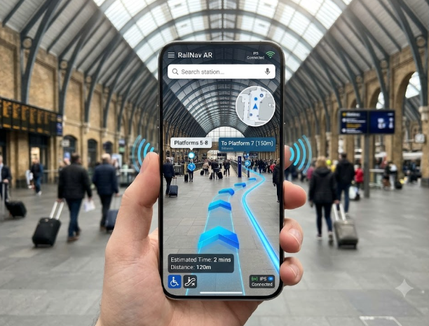
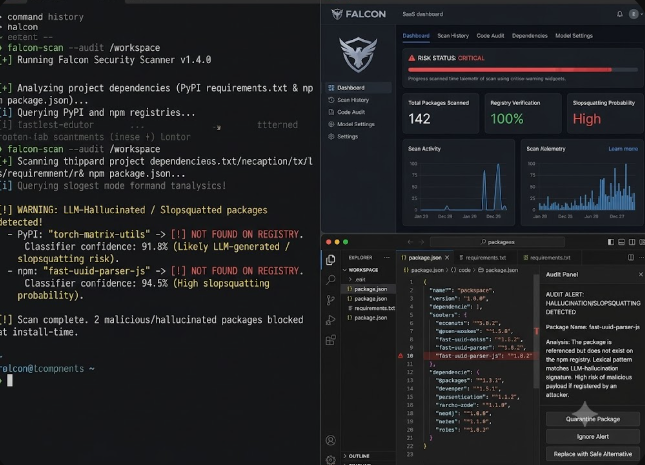
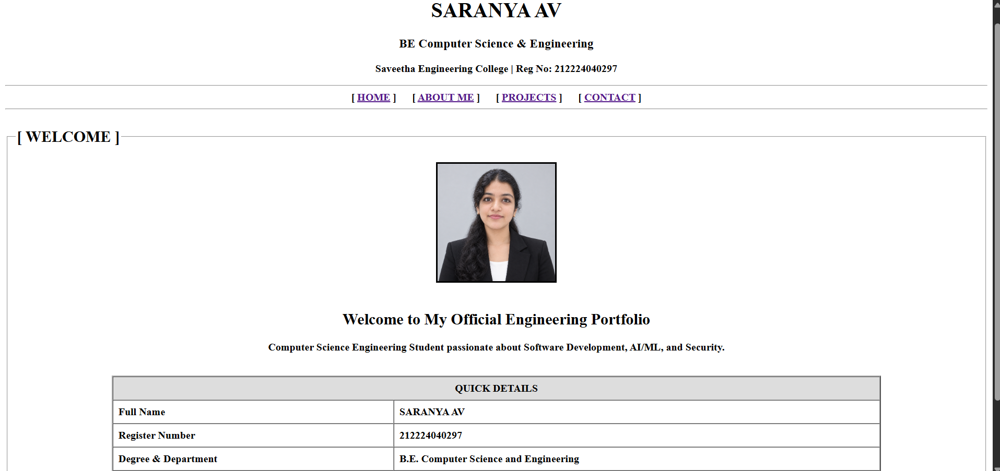
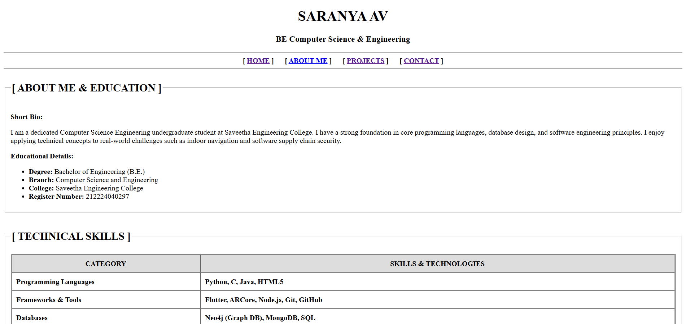
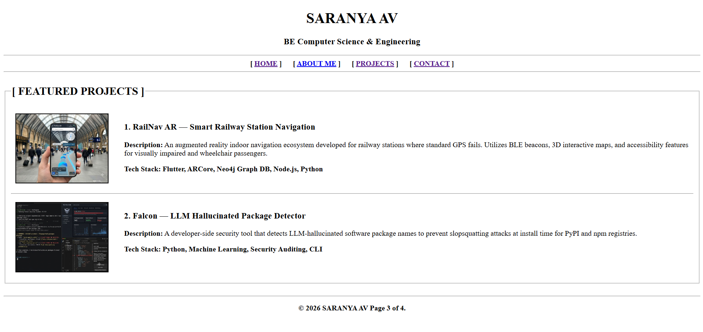
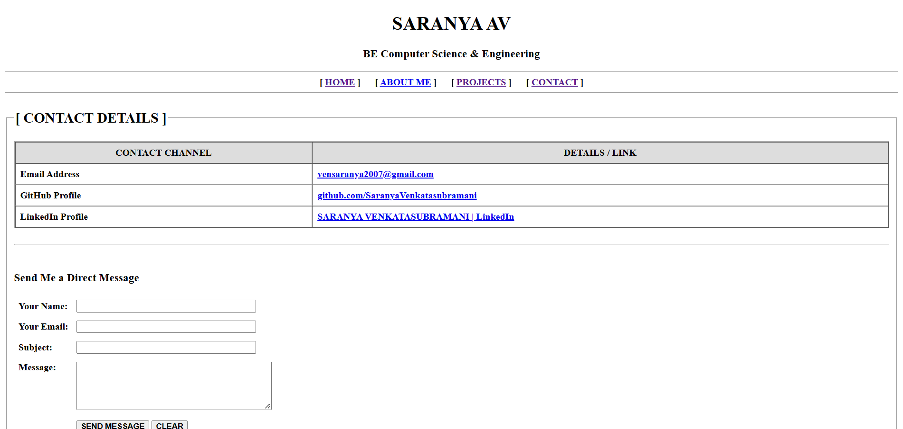

# Ex01 Portfolio
## Date: 30-10-2026

## AIM
To create a Portfolio using HTML and CSS.

## ALGORITHM
### STEP 1
Create an HTML file (index.html)

### STEP 2
Create a CSS file (style.css)

### STEP 3
Include a navigation bar with links to different sections.

### STEP 4
Add structured sections for introduction, about, projects, and contact details.

### STEP 5
Define global styles for fonts, colors, and layout.

### STEP 6
Style the header, navigation bar, and sections.

### STEP 7
Use Flexbox or CSS Grid for layout design.

### STEP 8
Add hover effects and transitions for interactivity.

### STEP 9
Add Images and Media.

### STEP 10
Use optimized images for a professional look.

### STEP 11
Open the HTML file in a browser to check layout and functionality.

### STEP 12
Fix styling issues and refine content placement.

### STEP 13
Deploy the Portfolio.

### STEP 14
Upload to GitHub Pages for free hosting.

## PROGRAM

index.html

```
<!DOCTYPE html>
<html lang="en">
<head>
    <meta charset="UTF-8">
    <title>SARANYA AV - Portfolio Home</title>
</head>
<body>

    <!-- Header & Navigation Bar -->
    <header>
        <center>
            <h1><b>SARANYA AV</b></h1>
            <h3><b>BE Computer Science & Engineering</b></h3>
            <p><b>Saveetha Engineering College | Reg No: 212224040297</b></p>
        </center>
        <hr>
        <nav>
            <center>
                <b>
                    [ <a href="index.html">HOME</a> ] &nbsp;&nbsp;&nbsp;&nbsp;
                    [ <a href="skills.html">ABOUT ME</a> ] &nbsp;&nbsp;&nbsp;&nbsp;
                    [ <a href="projects.html">PROJECTS</a> ] &nbsp;&nbsp;&nbsp;&nbsp;
                    [ <a href="contact.html">CONTACT</a> ]
                </b>
            </center>
        </nav>
        <hr>
    </header>

    <!-- Main Section -->
    <main>
        <fieldset>
            <legend><h2><b>[ WELCOME ]</b></h2></legend>
            <center>
                <!-- Profile Image Placeholder -->
                
                <br><br>
                <h2><b>Welcome to My Official Engineering Portfolio</b></h2>
                <p><b>Computer Science Engineering Student passionate about Software Development, AI/ML, and Security.</b></p>
                
                <br>
                <table border="2" cellpadding="8" cellspacing="0" width="80%">
                    <tr bgcolor="#dddddd">
                        <th colspan="2"><b>QUICK DETAILS</b></th>
                    </tr>
                    <tr>
                        <td><b>Full Name</b></td>
                        <td><b>SARANYA AV</b></td>
                    </tr>
                    <tr>
                        <td><b>Register Number</b></td>
                        <td><b>212224040297</b></td>
                    </tr>
                    <tr>
                        <td><b>Degree & Department</b></td>
                        <td><b>B.E. Computer Science and Engineering</b></td>
                    </tr>
                    <tr>
                        <td><b>Institution</b></td>
                        <td><b>Saveetha Engineering College</b></td>
                    </tr>
                </table>
            </center>
        </fieldset>
    </main>

    <br><hr>
    <footer>
        <center>
            <p><b>&copy; 2026 SARANYA AV  Page 1 of 4.</b></p>
        </center>
    </footer>

</body>
</html>
```

skills.html

```
<!DOCTYPE html>
<html lang="en">
<head>
    <meta charset="UTF-8">
    <title>SARANYA AV - About & Skills</title>
</head>
<body>

    <!-- Header & Navigation Bar -->
    <header>
        <center>
            <h1><b>SARANYA AV</b></h1>
            <h3><b>BE Computer Science & Engineering</b></h3>
        </center>
        <hr>
        <nav>
            <center>
                <b>
                    [ <a href="index.html">HOME</a> ] &nbsp;&nbsp;&nbsp;&nbsp;
                    [ <a href="about.html">ABOUT ME</a> ] &nbsp;&nbsp;&nbsp;&nbsp;
                    [ <a href="projects.html">PROJECTS</a> ] &nbsp;&nbsp;&nbsp;&nbsp;
                    [ <a href="contact.html">CONTACT</a> ]
                </b>
            </center>
        </nav>
        <hr>
    </header>

    <main>
        <!-- Bio & Education Section -->
        <fieldset>
            <legend><h2><b>[ ABOUT ME & EDUCATION ]</b></h2></legend>
            <p><b>Short Bio:</b></p>
            <p>I am a dedicated Computer Science Engineering undergraduate student at Saveetha Engineering College. I have a strong foundation in core programming languages, database design, and software engineering principles. I enjoy applying technical concepts to real-world challenges such as indoor navigation and software supply chain security.</p>
            
            <p><b>Educational Details:</b></p>
            <ul>
                <li><b>Degree:</b> Bachelor of Engineering (B.E.)</li>
                <li><b>Branch:</b> Computer Science and Engineering</li>
                <li><b>College:</b> Saveetha Engineering College</li>
                <li><b>Register Number:</b> 212224040297</li>
            </ul>
        </fieldset>

        <br>

        <!-- Technical Skills Section -->
        <fieldset>
            <legend><h2><b>[ TECHNICAL SKILLS ]</b></h2></legend>
            <table border="2" cellpadding="10" cellspacing="0" width="100%">
                <thead>
                    <tr bgcolor="#dddddd">
                        <th><b>CATEGORY</b></th>
                        <th><b>SKILLS & TECHNOLOGIES</b></th>
                    </tr>
                </thead>
                <tbody>
                    <tr>
                        <td><b>Programming Languages</b></td>
                        <td><b>Python, C, Java, HTML5</b></td>
                    </tr>
                    <tr>
                        <td><b>Frameworks & Tools</b></td>
                        <td><b>Flutter, ARCore, Node.js, Git, GitHub</b></td>
                    </tr>
                    <tr>
                        <td><b>Databases</b></td>
                        <td><b>Neo4j (Graph DB), MongoDB, SQL</b></td>
                    </tr>
                    <tr>
                        <td><b>Domain Knowledge</b></td>
                        <td><b>Indoor Positioning Systems, LLM Package Security, Data Structures</b></td>
                    </tr>
                </tbody>
            </table>
        </fieldset>
    </main>

    <br><hr>
    <footer>
        <center>
            <p><b>&copy; 2026 SARANYA AV Page 2 of 4.</b></p>
        </center>
    </footer>

</body>
</html>
```

projects.html

```
<!DOCTYPE html>
<html lang="en">
<head>
    <meta charset="UTF-8">
    <title>SARANYA AV - Projects</title>
</head>
<body>

    <!-- Header & Navigation Bar -->
    <header>
        <center>
            <h1><b>SARANYA AV</b></h1>
            <h3><b>BE Computer Science & Engineering</b></h3>
        </center>
        <hr>
        <nav>
            <center>
                <b>
                    [ <a href="index.html">HOME</a> ] &nbsp;&nbsp;&nbsp;&nbsp;
                    [ <a href="about.html">ABOUT ME</a> ] &nbsp;&nbsp;&nbsp;&nbsp;
                    [ <a href="projects.html">PROJECTS</a> ] &nbsp;&nbsp;&nbsp;&nbsp;
                    [ <a href="contact.html">CONTACT</a> ]
                </b>
            </center>
        </nav>
        <hr>
    </header>

    <main>
        <fieldset>
            <legend><h2><b>[ FEATURED PROJECTS ]</b></h2></legend>

            <!-- Project 1 -->
            <article>
                <table border="0" cellpadding="8">
                    <tr>
                        <td valign="top" width="220">
                            
                        </td>
                        <td valign="top">
                            <h3><b>1. RailNav AR — Smart Railway Station Navigation</b></h3>
                            <p><b>Description:</b> An augmented reality indoor navigation ecosystem developed for railway stations where standard GPS fails. Utilizes BLE beacons, 3D interactive maps, and accessibility features for visually impaired and wheelchair passengers.</p>
                            <p><b>Tech Stack:</b> <b>Flutter, ARCore, Neo4j Graph DB, Node.js, Python</b></p>
                        </td>
                    </tr>
                </table>
            </article>

            <hr>

            <!-- Project 2 -->
            <article>
                <table border="0" cellpadding="8">
                    <tr>
                        <td valign="top" width="220">
                            
                        </td>
                        <td valign="top">
                            <h3><b>2. Falcon — LLM Hallucinated Package Detector</b></h3>
                            <p><b>Description:</b> A developer-side security tool that detects LLM-hallucinated software package names to prevent slopsquatting attacks at install time for PyPI and npm registries.</p>
                            <p><b>Tech Stack:</b> <b>Python, Machine Learning, Security Auditing, CLI</b></p>
                        </td>
                    </tr>
                </table>
            </article>
        </fieldset>
    </main>

    <br><hr>
    <footer>
        <center>
            <p><b>&copy; 2026 SARANYA AV  Page 3 of 4.</b></p>
        </center>
    </footer>

</body>
</html>

```

contact.html
```
<!DOCTYPE html>
<html lang="en">
<head>
    <meta charset="UTF-8">
    <title>SARANYA AV - Contact</title>
</head>
<body>

    <!-- Header & Navigation Bar -->
    <header>
        <center>
            <h1><b>SARANYA AV</b></h1>
            <h3><b>BE Computer Science & Engineering</b></h3>
        </center>
        <hr>
        <nav>
            <center>
                <b>
                    [ <a href="index.html">HOME</a> ] &nbsp;&nbsp;&nbsp;&nbsp;
                    [ <a href="about.html">ABOUT ME</a> ] &nbsp;&nbsp;&nbsp;&nbsp;
                    [ <a href="projects.html">PROJECTS</a> ] &nbsp;&nbsp;&nbsp;&nbsp;
                    [ <a href="contact.html">CONTACT</a> ]
                </b>
            </center>
        </nav>
        <hr>
    </header>

    <main>
        <fieldset>
            <legend><h2><b>[ CONTACT DETAILS ]</b></h2></legend>

            <!-- Contact Information Table -->
            <table border="2" cellpadding="8" cellspacing="0" width="100%">
                <tr bgcolor="#dddddd">
                    <th><b>CONTACT CHANNEL</b></th>
                    <th><b>DETAILS / LINK</b></th>
                </tr>
                <tr>
                    <td><b>Email Address</b></td>
                    <td><b><a href="mailto:vensaranya2007@gmail.com">vensaranya2007@gmail.com</a></b></td>
                </tr>
                <tr>
                    <td><b>GitHub Profile</b></td>
                    <td><b><a href="https://github.com/SaranyaVenkatasubramani" target="_blank">github.com/SaranyaVenkatasubramani</a></b></td>
                </tr>
                <tr>
                    <td><b>LinkedIn Profile</b></td>
                    <td><b><a href="https://www.linkedin.com/in/saranya-venkatasubramani" target="_blank">SARANYA VENKATASUBRAMANI | LinkedIn</a></b></td>
                </tr>
            </table>

            <br><hr><br>

            <h3><b>Send Me a Direct Message</b></h3>
            <form>
                <table border="0" cellpadding="6">
                    <tr>
                        <td><b><label for="name">Your Name:</label></b></td>
                        <td><input type="text" id="name" name="name" size="40" required></td>
                    </tr>
                    <tr>
                        <td><b><label for="email">Your Email:</label></b></td>
                        <td><input type="email" id="email" name="email" size="40" required></td>
                    </tr>
                    <tr>
                        <td><b><label for="subject">Subject:</label></b></td>
                        <td><input type="text" id="subject" name="subject" size="40" required></td>
                    </tr>
                    <tr>
                        <td valign="top"><b><label for="msg">Message:</label></b></td>
                        <td><textarea id="msg" name="msg" rows="5" cols="42" required></textarea></td>
                    </tr>
                    <tr>
                        <td></td>
                        <td>
                            <button type="submit"><b>SEND MESSAGE</b></button>
                            <button type="reset"><b>CLEAR</b></button>
                        </td>
                    </tr>
                </table>
            </form>
        </fieldset>
    </main>

    <br><hr>
    <footer>
        <center>
            <p><b>&copy; 2026 SARANYA AV Page 4 of 4.</b></p>
        </center>
    </footer>

</body>
</html>
```


## OUTPUT






## RESULT
The program for creating Portfolio using HTML and CSS is executed successfully.
